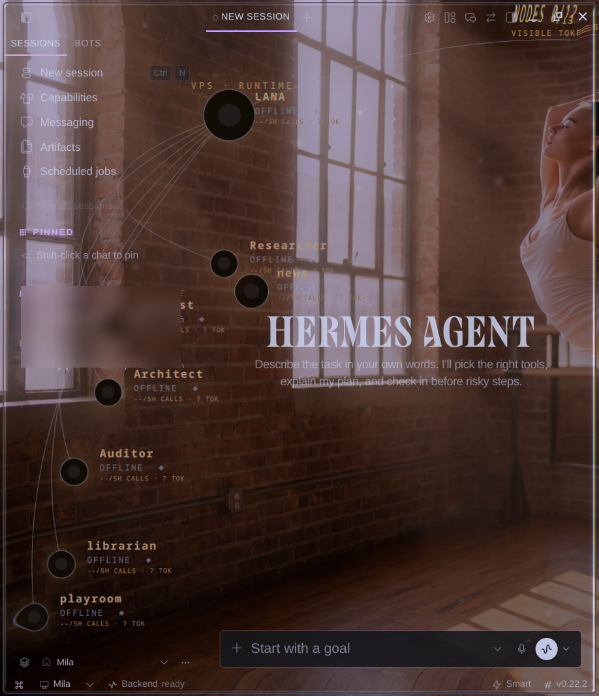

# Hermes Desktop — Linux Glass

Real glass for the [Hermes Agent](https://github.com/NousResearch/hermes-agent) desktop app on Linux. The window background becomes see-through so your compositor's glass shows behind it, and the **text stays fully opaque and crisp**.



## Why this exists

Hermes Desktop already has a lovely **Glass** mode on macOS (vibrancy) and Windows 11 (Mica/Acrylic). On Linux the setting is hidden, because Electron has no native window material there.

But a Linux compositor can be that material. [True Glass](https://github.com/Eddie175/omarchy-true-glass), built on [hyprglass](https://github.com/hyprnux/hyprglass), draws refracting glass behind any window with transparent pixels, and that's exactly why your terminals look so good. Hermes simply never handed it any transparent pixels.

The usual workaround, a Hyprland `opacity` window rule, fades **everything**, the text included. This patch does it properly:

| | Hyprland `opacity` rule | This patch |
|---|---|---|
| Background | see-through | see-through |
| Text | faded | **solid** |
| Compositor glass/blur | yes | yes |
| Adjustable in Hermes Settings | no | **yes** (Tint slider) |

## What it changes

One file, `apps/desktop/electron/main.ts`, about 30 lines:

- Detects a Hyprland session (`HYPRLAND_INSTANCE_SIGNATURE`) and turns on the existing Glass/Translucency support for Linux.
- Creates chat windows with `transparent: true` and a `#00000000` backing. Electron only allows this when the window is created.
- Everything else is Hermes' own Glass mode. Its CSS already clears the panel backgrounds and keeps cards, popovers and text opaque.

Override with an environment variable:

```bash
HERMES_DESKTOP_LINUX_GLASS=1   # force on (e.g. KDE/KWin blur, other compositors)
HERMES_DESKTOP_LINUX_GLASS=0   # force off
```

## Requirements

- Linux with a compositor that draws blur or glass behind transparent windows. Tested on **Omarchy 4 / Hyprland 0.56 + True Glass**.
- Hermes Agent **source install** (the install script plus `hermes desktop`), checked out at **v0.22.2**.
- `git`, `node` and `npm` to build the desktop app.

## Install

```bash
git clone https://github.com/martyllmaccs-hash/hermes-desktop-linux-glass
cd hermes-desktop-linux-glass
./install.sh                 # or: ./install.sh /path/to/hermes-agent
```

Then:

1. Quit Hermes completely (tray → Quit) and reopen it.
2. Open **Settings → Appearance → Window & layout → Window Translucency**.
3. Choose **Glass** and raise **Tint**.

**Fade** does nothing on Linux, because it uses `setOpacity`, which Electron doesn't support there. Leave it at 0.

If you have a Hyprland `opacity` rule for `com.nousresearch.hermes`, remove it. It fades the text again. The installer warns you if it finds one.

## Uninstall

```bash
./uninstall.sh
```

This restores the previous build that the installer saved as a backup. Quit and reopen Hermes afterwards.

## After a Hermes update

`hermes update` replaces the desktop build. Run `./install.sh` again. If the patch no longer applies cleanly to a newer version, please open an issue.

## Known limits

- Electron documents transparent windows on Linux as "quirky". Resizing a tiled window in Hyprland works fine, but floating-window shadows or some popups may look different. Please report anything odd.
- Browser web apps (Discord/WhatsApp via `omarchy-launch-webapp`) can't use this. Web pages render on an opaque canvas.
- Not affiliated with Nous Research. It's an unofficial patch, and the hope is that it gets upstreamed.

## License

MIT. Hermes Agent is also MIT, © Nous Research.
